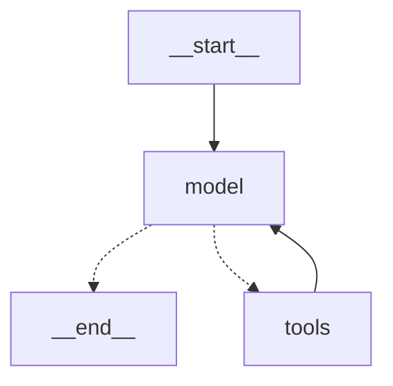

# Day 02：LangGraph 状态、节点与条件路由

## 官方 API 依据

官方文档：https://docs.langchain.com/oss/python/langgraph/graph-api

当前 `langgraph 1.2.8` 环境确认：

```python
from langgraph.graph import END, START, StateGraph
```

```text
StateGraph(state_schema, context_schema=None, *, input_schema=None, output_schema=None)
StateGraph.add_node(...)  添加节点
StateGraph.add_edge(...)  添加固定边
StateGraph.compile(...)   校验并编译为 CompiledStateGraph
START                     固定入口标记，内部值为 "__start__"
END                       固定终点标记，内部值为 "__end__"
```

名称分类：

```text
StateGraph、START、END、add_node、add_edge、compile  LangGraph 固定 API
State、builder、graph、classify_intent                开发者自定义名称
```

## 今日目标

不依赖预构建 Agent，亲手完成一个可观察的状态图，让请求在“普通回答、搜索灵感、保存灵感”之间路由。

## 今日时间表

1. 09:00-10:30：学习 State、Node、Edge、START、END。
2. 10:45-12:00：实现三个纯 Python 节点。
3. 14:00-15:30：加入条件路由。
4. 15:45-17:00：绘制和调试执行路径。
5. 17:00-18:00：测试状态更新规则。

## 必学知识

- `【非常重点】State`：整个工作流共享的数据契约，不是随意堆变量的字典。
- `【非常重点】Node`：读取 State 并返回部分状态更新的函数。
- `【非常重点】Conditional Edge`：根据确定的路由结果选择下一节点。
- `【非常重点】Reducer`：定义多个更新如何合并，消息列表通常不是简单覆盖。
- `【重点】START/END`：显式表示图的入口和终点。

## 检查点 1：最小确定性 StateGraph

```python
from typing_extensions import TypedDict
from langgraph.graph import END, START, StateGraph


class State(TypedDict):
    text: str
    result: str


def process_text(state: State) -> dict[str, str]:
    """读取当前 State，并返回需要更新的字段。"""
    return {"result": f"已处理：{state['text']}"}


builder = StateGraph(State)
builder.add_node("process_text", process_text)
builder.add_edge(START, "process_text")
builder.add_edge("process_text", END)

graph = builder.compile()

result = graph.invoke({
    "text": "学习 LangGraph",
    "result": "",
})

print(result)
```

预期输出：

```python
{
    "text": "学习 LangGraph",
    "result": "已处理：学习 LangGraph",
}
```

### 为什么输出中的 result 有内容

初始 State 是：

```python
{
    "text": "学习 LangGraph",
    "result": "",
}
```

节点收到这个字典后执行：

```python
return {"result": f"已处理：{state['text']}"}
```

节点只返回 `result` 字段的更新。LangGraph 默认保留没有更新的 `text`，并使用新值覆盖旧的 `result`：

```python
{
    "text": "学习 LangGraph",
    "result": "已处理：学习 LangGraph",
}
```

外层变量也叫 `result`，只是示例变量名。为避免混淆，可以改成：

```python
final_state = graph.invoke(...)
print(final_state)
```

### `State` 类在两个位置的不同含义

```python
builder = StateGraph(State)
```

这里真的把 `State` 这个 Schema 类对象传给 `StateGraph`，让 LangGraph 知道允许哪些状态字段。

```python
def process_text(state: State) -> dict[str, str]:
```

这里的 `state: State` 是类型注解，表示参数 `state` 应符合 `State` 描述的字典结构；真正传入节点的值仍然是一个普通字典。

```python
class State(TypedDict):
    text: str
    result: str
```

`TypedDict` 主要用于类型检查和 Schema 描述，不像 Pydantic 那样自动执行完整的运行时数据校验。

### State 是共享状态，不是初始节点

```python
builder = StateGraph(State)
```

这行声明图使用 `State` 作为共享状态 Schema，并没有创建名为 `State` 的节点。初始状态直到调用 `invoke()` 时才真正传入：

```python
final_state = graph.invoke({"text": "学习 LangGraph", "result": ""})
```

当前图只有一个真正执行代码的节点 `process_text`；`START` 和 `END` 是 LangGraph 提供的虚拟入口与虚拟终点：

```text
初始 State
    |
  START（虚拟入口）
    |
process_text（真实节点）
    |
  END（虚拟终点）
    |
最终 State
```

可以在概念上把状态更新理解为：

```python
current_state = {"text": "学习 LangGraph", "result": ""}
update = process_text(current_state)
# update == {"result": "已处理：学习 LangGraph"}

next_state = current_state | update
# next_state == {"text": "学习 LangGraph", "result": "已处理：学习 LangGraph"}
```

以上代码只是帮助理解。真正的合并由 LangGraph 根据每个状态字段的 Reducer 完成。节点应返回需要更新的字段，通常不要直接原地修改收到的 `state`。

所以在顺序图中，可以把它理解成“同一份共享状态在各节点之间逐步演化”；但实现上不要把它理解成所有节点共同修改同一个 Python 全局变量。并行分支存在时，各分支会产生各自的更新，再由 Reducer 合并。

### “最小确定性”不是固定 API

```text
最小：只有一个 State、一个 Node 和两条固定 Edge。
确定性：不调用 LLM、随机数、网络或数据库，相同输入得到相同输出。
```

这是课程对实验的描述，不是 LangGraph 的类名或特殊语法。

执行路径：

```text
START -> process_text -> END
```

名称分类：

```text
StateGraph、START、END、add_node、add_edge、compile、invoke  固定 API
State、process_text、builder、graph、result                    自定义名称
"process_text"                                                自定义节点名称
```

### 建图代码：固定 API 与自定义内容

| 代码 | 类型 | 是否固定 | 含义 |
|---|---|---|---|
| `StateGraph` | LangGraph 类 | 固定 | 创建状态图构建器 |
| `State` | Schema 类 | 自定义 | 描述工作流状态结构 |
| `builder` | Python 变量 | 自定义 | 保存 `StateGraph(State)` 创建的对象，可改名 |
| `add_node()` | 对象方法 | 固定 | 向图中注册节点 |
| `"process_text"` | 节点名称 | 自定义 | 节点在图里的唯一名称 |
| `process_text` | Python 函数 | 自定义 | 节点真正执行的代码；这里传函数对象，不能加括号 |
| `add_edge()` | 对象方法 | 固定 | 指定两个节点之间的执行方向 |
| `START` | LangGraph 常量 | 固定 | 虚拟起点 |
| `END` | LangGraph 常量 | 固定 | 虚拟终点 |

逐行翻译：

```python
builder = StateGraph(State)                    # 创建一个使用 State Schema 的建图器
builder.add_node("process_text", process_text) # 注册节点名称和节点函数
builder.add_edge(START, "process_text")        # 从入口进入 process_text
builder.add_edge("process_text", END)          # process_text 完成后结束
```

`builder` 不是 LangGraph 规定的变量名，下面的写法完全等价：

```python
graph_builder = StateGraph(State)
graph_builder.add_node("process_text", process_text)
graph_builder.add_edge(START, "process_text")
graph_builder.add_edge("process_text", END)
```

这里的 `add_node` 和 `add_edge` 准确地说是 `StateGraph` 对象的方法，不是独立函数。方法名称和参数规则由 LangGraph API 规定，但节点名称与节点函数由开发者定义。

## 检查点 2：两个节点共享并更新 State

本检查点不引入新 API，继续使用官方的 `StateGraph`、`add_node()`、`add_edge()`、`compile()` 和 `invoke()`。

```python
from typing_extensions import TypedDict
from langgraph.graph import END, START, StateGraph


class State(TypedDict):
    text: str
    cleaned_text: str
    result: str


def clean_text(state: State) -> dict[str, str]:
    """清理用户输入，并只返回需要更新的字段。"""
    print("clean_text 收到：", state)
    cleaned = state["text"].strip()
    return {"cleaned_text": cleaned}


def build_result(state: State) -> dict[str, str]:
    """读取上一个节点写入的 cleaned_text。"""
    print("build_result 收到：", state)
    return {"result": f"已处理：{state['cleaned_text']}"}


builder = StateGraph(State)
builder.add_node("clean_text", clean_text)
builder.add_node("build_result", build_result)

builder.add_edge(START, "clean_text")
builder.add_edge("clean_text", "build_result")
builder.add_edge("build_result", END)

graph = builder.compile()

final_state = graph.invoke({
    "text": "  学习 LangGraph  ",
    "cleaned_text": "",
    "result": "",
})

print("最终状态：", final_state)
```

执行路径：

```text
START -> clean_text -> build_result -> END
```

状态变化：

```text
初始：      text="  学习 LangGraph  ", cleaned_text="", result=""
clean_text：返回 cleaned_text="学习 LangGraph"
合并后：    text="  学习 LangGraph  ", cleaned_text="学习 LangGraph", result=""
build_result：读取新的 cleaned_text，返回 result="已处理：学习 LangGraph"
最终：      三个字段都保留，result 已被更新
```

`【非常重点】` Edge 负责控制执行顺序，State 负责在节点之间传递数据，Node 负责读取 State 并返回部分更新。这三者不要混为一谈。

### 更新发生在什么时候

节点中的 `state` 是该节点开始执行时收到的状态快照。节点先计算，再通过 `return` 把部分更新交给 LangGraph：

```text
LangGraph 把当前 State 传给 clean_text
    -> clean_text 打印收到的旧 State
    -> clean_text 计算并 return {"cleaned_text": "学习 LangGraph"}
    -> LangGraph Runtime 根据 Reducer 合并更新
    -> LangGraph 沿 Edge 调用 build_result
    -> build_result 收到并打印合并后的新 State
```

因此，更新不是等到下一个节点才发生，而是发生在“上一个节点返回之后、下一个节点执行之前”。由于示例没有在两者之间打印，所以第一次看到新状态是在下一个节点中。

可以打印节点准备提交的更新：

```python
def clean_text(state: State) -> dict[str, str]:
    update = {"cleaned_text": state["text"].strip()}
    print("clean_text 准备返回：", update)
    return update
```

不要依赖 `state["cleaned_text"] = ...` 进行原地修改。LangGraph 的标准节点模型是“读取状态快照，返回部分更新”，这样才能统一处理 Reducer、并行更新、检查点和重试。

本检查点验收：

1. 运行代码并贴出两个节点打印的 State 和最终状态。
2. 能解释为什么 `build_result` 可以读到 `clean_text` 返回的 `cleaned_text`。
3. 暂时不要加入 LLM；确认状态传递后再学习条件边。

## 检查点 3：使用条件边选择执行分支

官方 API：

```text
StateGraph.add_conditional_edges(source, path, path_map=None)
```

- `source`：哪个节点执行结束后开始判断。
- `path`：读取当前 State 并返回路线值的路由函数。
- `path_map`：把路线值映射到真正的节点名称。

```python
from typing_extensions import TypedDict
from langgraph.graph import END, START, StateGraph


class State(TypedDict):
    text: str
    intent: str
    result: str


def classify_intent(state: State) -> dict[str, str]:
    """节点：判断意图，并更新 State。"""
    text = state["text"]

    if "保存" in text:
        intent = "save"
    elif "搜索" in text:
        intent = "search"
    else:
        intent = "chat"

    print("分类结果：", intent)
    return {"intent": intent}


def route_by_intent(state: State) -> str:
    """路由函数：只决定下一步路线，不更新 State。"""
    print("路由读取：", state["intent"])
    return state["intent"]


def save_node(state: State) -> dict[str, str]:
    return {"result": f"已保存：{state['text']}"}


def search_node(state: State) -> dict[str, str]:
    return {"result": f"正在搜索：{state['text']}"}


def chat_node(state: State) -> dict[str, str]:
    return {"result": f"普通回答：{state['text']}"}


builder = StateGraph(State)

builder.add_node("classify", classify_intent)
builder.add_node("save_action", save_node)
builder.add_node("search_action", search_node)
builder.add_node("chat_action", chat_node)

builder.add_edge(START, "classify")

builder.add_conditional_edges(
    "classify",
    route_by_intent,
    {
        "save": "save_action",
        "search": "search_action",
        "chat": "chat_action",
    },
)

builder.add_edge("save_action", END)
builder.add_edge("search_action", END)
builder.add_edge("chat_action", END)

graph = builder.compile()

final_state = graph.invoke({
    "text": "请保存这个灵感",
    "intent": "",
    "result": "",
})

print("最终状态：", final_state)
```

执行过程：

```text
START
  -> classify（更新 intent）
  -> route_by_intent（读取 intent 并返回路线值）
     -> save_action / search_action / chat_action（三选一）
  -> END
```

固定与自定义：

| 内容 | 是否固定 | 作用 |
|---|---|---|
| `add_conditional_edges()` | 固定 API | 注册条件路线 |
| `"classify"` | 自定义 | 条件判断发生在哪个节点之后 |
| `route_by_intent` | 自定义函数 | 返回路线值 |
| `{"save": "save_action", ...}` | 自定义字典 | 路线值到节点名的映射 |

`【非常重点】` `classify_intent` 是 Node，所以返回字典并更新 State；`route_by_intent` 是路由函数，所以返回字符串并决定下一节点。二者职责不同。

### 为什么条件边后面还有一个字典

```python
builder.add_conditional_edges(
    "classify",
    route_by_intent,
    {
        "save": "save_action",
        "search": "search_action",
        "chat": "chat_action",
    },
)
```

第三个参数是可选的 `path_map`，它不是 State，也不负责再次判断，而是把路由函数的返回值映射为真实节点名：

```python
route_value = route_by_intent(state)  # "save"
next_node = path_map[route_value]      # "save_action"
```

字典左边必须匹配路由函数可能返回的值，右边必须匹配 `add_node()` 注册的节点名称。

如果路由函数直接返回真实节点名，就可以省略第三个字典：

```python
def route_by_intent(state: State) -> str:
    if state["intent"] == "save":
        return "save_action"
    if state["intent"] == "search":
        return "search_action"
    return "chat_action"

builder.add_conditional_edges("classify", route_by_intent)
```

保留 `path_map` 的好处是把业务判断值（如 `save`）与图中的节点名称（如 `save_action`）分离，路线也更容易集中查看和修改。

测试三次：

```python
test_inputs = [
    "请保存这个灵感",
    "搜索聊天灵感",
    "解释一下 LangGraph",
]

for text in test_inputs:
    final_state = graph.invoke({"text": text, "intent": "", "result": ""})
    print(final_state)
```

预期分别进入 `save_action`、`search_action`、`chat_action`。

## 检查点 4：Reducer 决定覆盖还是合并

官方规则：State 中的每个字段都有自己的更新规则。没有显式 Reducer 时，新值默认覆盖旧值；使用 `Annotated` 指定 Reducer 后，由 Reducer 合并旧值与新值。

```python
from operator import add
from typing import Annotated
from typing_extensions import TypedDict
from langgraph.graph import END, START, StateGraph


class State(TypedDict):
    text: str
    steps: Annotated[list[str], add]
    result: str


def clean_text(state: State) -> dict:
    return {
        "text": state["text"].strip(),
        "steps": ["clean_text"],
    }


def build_result(state: State) -> dict:
    return {
        "result": f"已处理：{state['text']}",
        "steps": ["build_result"],
    }


builder = StateGraph(State)
builder.add_node("clean_text", clean_text)
builder.add_node("build_result", build_result)
builder.add_edge(START, "clean_text")
builder.add_edge("clean_text", "build_result")
builder.add_edge("build_result", END)

graph = builder.compile()

final_state = graph.invoke({
    "text": "  学习 Reducer  ",
    "steps": [],
    "result": "",
})

print(final_state)
```

预期结果：

```python
{
    "text": "学习 Reducer",
    "steps": ["clean_text", "build_result"],
    "result": "已处理：学习 Reducer",
}
```

语法拆解：

```python
steps: Annotated[list[str], add]
```

- `steps`：自定义 State 字段。
- `list[str]`：字段值必须是字符串列表。
- `Annotated`：Python 类型系统提供的固定工具，可给类型附加元数据。
- `add`：Python `operator` 模块提供的函数，LangGraph将它用作该字段的 Reducer。

概念上每次更新相当于：

```python
merged_steps = add(old_steps, new_steps)
# 等价于 old_steps + new_steps
```

如果改回下面的普通字段：

```python
steps: list[str]
```

第二个节点返回的 `["build_result"]` 会覆盖第一个节点的 `["clean_text"]`，最终只剩最后一项。

`【非常重点】` Reducer 是每个 State 字段自己的合并规则，不是节点，也不是边。节点仍然只返回部分更新，LangGraph Runtime 调用 Reducer 完成合并。

本检查点验收：

1. 先使用 `Annotated[list[str], add]` 运行，确认保留两个步骤。
2. 再改成 `steps: list[str]` 运行，确认只保留最后一步。
3. 能解释为什么对话消息列表必须使用合适的 Reducer。

## 检查点 5：MessagesState 与 add_messages

Agent 的聊天记录通常保存在 `messages` 字段中。LangGraph提供了专用 Reducer `add_messages`，并提供了已经配置好该字段的快捷 State：`MessagesState`。

官方定义可理解为：

```python
class MessagesState(TypedDict):
    messages: Annotated[list[AnyMessage], add_messages]
```

因此 `StateGraph(MessagesState)` 在读取 State Schema 时，会发现 `messages` 字段绑定了 `add_messages` Reducer。节点返回 `{"messages": [new_message]}` 后，LangGraph Runtime 概念上执行：

```python
merged_messages = add_messages(old_messages, new_messages)
```

不是 `MessagesState` 这个名称自动产生合并效果，而是它内部 `Annotated` 元数据中指定的 `add_messages` 产生效果。若改成普通的 `messages: list[AnyMessage]`，默认行为就是覆盖。

注意术语：`Reducer` 是状态合并函数；`Redis` 是独立的缓存/数据库服务，二者没有关系。

练习代码：

```python
from langchain.messages import AIMessage, HumanMessage
from langgraph.graph import END, START, MessagesState, StateGraph


def acknowledge(state: MessagesState) -> dict:
    user_text = state["messages"][-1].content
    return {
        "messages": [AIMessage(content=f"收到：{user_text}")]
    }


def suggest_next_step(state: MessagesState) -> dict:
    return {
        "messages": [AIMessage(content="下一步：学习消息状态的累积。")]
    }


builder = StateGraph(MessagesState)
builder.add_node("acknowledge", acknowledge)
builder.add_node("suggest_next_step", suggest_next_step)
builder.add_edge(START, "acknowledge")
builder.add_edge("acknowledge", "suggest_next_step")
builder.add_edge("suggest_next_step", END)

graph = builder.compile()

final_state = graph.invoke({
    "messages": [HumanMessage(content="学习 LangGraph")]
})

for message in final_state["messages"]:
    print(type(message).__name__, message.content)
```

预期输出：

```text
HumanMessage 学习 LangGraph
AIMessage 收到：学习 LangGraph
AIMessage 下一步：学习消息状态的累积。
```

固定与自定义：

| 内容 | 是否固定 | 作用 |
|---|---|---|
| `MessagesState` | LangGraph 固定类型 | 提供配置好 Reducer 的 `messages` 字段 |
| `add_messages` | LangGraph 固定 Reducer | 添加新消息，并按消息 ID 更新已有消息 |
| `HumanMessage`、`AIMessage` | LangChain 固定消息类 | 分别表示用户和模型消息 |
| `acknowledge`、`suggest_next_step` | 自定义函数 | 当前图中的节点逻辑 |

`add_messages` 比普通 `operator.add` 更适合消息，因为它不仅追加新消息，还能根据相同消息 ID 替换已有消息，并把支持的字典格式转换成 Message 对象。

需要额外业务字段时，可以继承官方的 `MessagesState`：

```python
class State(MessagesState):
    topic: str
    result: str
```

`【非常重点】` 节点返回 `{"messages": [new_message]}` 即可。不要返回 `state["messages"] + [new_message]`，否则 Reducer 还会再次合并旧消息，容易造成重复。

本检查点验收：

1. 输出中依次出现一条 HumanMessage 和两条 AIMessage。
2. 能解释 `MessagesState` 是预制 State，而 `add_messages` 才是真正的 Reducer。
3. 能解释节点为什么只返回本次新增的消息。

### messages 中保存的是什么类型

```python
state["messages"]
```

运行时类型是 Python `list`。它的类型标注是 `list[AnyMessage]`，表示列表中的元素可以是 LangChain 支持的任意消息类型。

```text
BaseMessage
├── SystemMessage  系统指令
├── HumanMessage   用户输入
├── AIMessage      模型回复或工具调用请求
└── ToolMessage    工具执行结果
```

这些名称是类，调用类以后得到对象或实例：

```python
HumanMessage                         # 类
HumanMessage(content="你好")         # HumanMessage 实例
type(HumanMessage(content="你好"))   # <class '...HumanMessage'>
```

`AnyMessage` 是用于类型标注的联合类型，表示上述多种消息及其流式 Chunk 类型，不是通常直接调用来创建实例的类。

示例：

```python
from langchain.messages import (
    AIMessage,
    HumanMessage,
    SystemMessage,
    ToolMessage,
)
from langchain_core.messages import BaseMessage

messages = [
    SystemMessage(content="你是灵感助手"),
    HumanMessage(content="保存这个灵感"),
    AIMessage(content="我准备调用保存工具"),
    ToolMessage(content="保存成功", tool_call_id="call_123"),
]

print(type(messages))                       # <class 'list'>
print(type(messages[1]))                    # HumanMessage 类
print(isinstance(messages[1], BaseMessage)) # True
```

当前环境中，具体消息类和 `AnyMessage` 可从 `langchain.messages` 导入；`BaseMessage` 从 `langchain_core.messages` 导入。

### `{"messages": [AIMessage(...)]}` 的三层结构

```python
return {
    "messages": [AIMessage(content=f"收到：{user_text}")]
}
```

这段代码包含三层对象：

```text
dict
└── key: "messages"
    └── value: list
        └── AIMessage 实例
            └── content: str
```

它不是修改旧 AIMessage，而是创建一条新的 AIMessage，并把它作为 `messages` 字段的本次更新返回。LangGraph随后使用 `add_messages` 把它合并进已有消息列表。

```python
user_text = "学习 LangGraph"
new_message = AIMessage(content=f"收到：{user_text}")
update = {"messages": [new_message]}

print(type(update))                 # dict
print(type(update["messages"]))     # list
print(type(update["messages"][0]))  # AIMessage
print(update["messages"][0].content)# 收到：学习 LangGraph
```

常见字段：

| 消息类 | 主要字段 | 说明 |
|---|---|---|
| `SystemMessage` | `content` | 系统规则或角色说明 |
| `HumanMessage` | `content` | 用户输入 |
| `AIMessage` | `content`、`tool_calls`、`usage_metadata` | 模型正文、工具调用请求、用量信息 |
| `ToolMessage` | `content`、`tool_call_id`、`status`、`artifact` | 工具结果及其对应调用 ID |

当前版本中 `content` 支持字符串、内容块列表或空值。入门阶段通常使用字符串；只有工具调用的 AIMessage 可能出现空正文，而 ToolMessage 必须提供 `tool_call_id` 来对应先前的工具调用。

## 检查点 6：在 StateGraph 节点中调用真实 LLM

官方推荐的模型节点模式：读取 `state["messages"]`，调用 ChatModel，得到 AIMessage，再把它作为本次消息更新返回。

```python
from langchain.messages import HumanMessage, SystemMessage
from langgraph.graph import END, START, MessagesState, StateGraph

from demo1 import llm


def call_model(state: MessagesState) -> dict:
    print("模型收到的消息数：", len(state["messages"]))

    response = llm.invoke(state["messages"])

    print("模型返回类型：", type(response))
    return {"messages": [response]}


builder = StateGraph(MessagesState)
builder.add_node("model", call_model)
builder.add_edge(START, "model")
builder.add_edge("model", END)

graph = builder.compile()

final_state = graph.invoke({
    "messages": [
        SystemMessage(content="你是一位耐心的 LangGraph 老师。"),
        HumanMessage(content="用一句话解释 State。"),
    ]
})

for message in final_state["messages"]:
    message.pretty_print()
```

如果练习文件位于 `Day2` 子目录而当前运行配置无法找到 `demo1`，应按项目包结构调整导入路径，例如从项目根目录运行并使用 `from langchain_demo.demo1 import llm`。不要复制 API Key 到练习文件。

这里存在两次不同的 `invoke()`：

```text
graph.invoke(initial_state)
    启动整张图
        -> LangGraph 调用 model 节点
            -> llm.invoke(state["messages"])
                调用一次真实模型并返回 AIMessage
        -> 节点返回 {"messages": [response]}
    -> add_messages 合并 AIMessage
    -> 返回最终 State
```

固定与自定义：

| 内容 | 属于谁 | 作用 |
|---|---|---|
| `graph.invoke()` | 编译后的 LangGraph | 执行整个工作流 |
| `llm.invoke()` | LangChain ChatModel | 调用一次模型 |
| `state["messages"]` | MessagesState | 传给模型的完整当前上下文 |
| `response` | 自定义变量 | 保存模型返回的 AIMessage |
| `{"messages": [response]}` | 节点状态更新 | 将新 AIMessage 交给 Reducer 合并 |

`【非常重点】` `llm.invoke()` 返回的是单个 AIMessage；State 中的 `messages` 是列表，所以节点需要返回 `{"messages": [response]}`，用列表包住这条新消息。

本检查点验收：

1. `type(response)` 显示 AIMessage。
2. 最终消息依次包含 SystemMessage、HumanMessage、AIMessage。
3. 能分别解释 `graph.invoke()` 和 `llm.invoke()` 调用了什么。

## 检查点 7：LLM 结构化分类与条件路由

这是 Day 02 的综合练习：LLM负责理解自然语言并输出受约束的意图，LangGraph负责按确定的代码路径路由。

```python
from typing import Literal

from langchain.messages import AIMessage, HumanMessage, SystemMessage
from langgraph.graph import END, START, MessagesState, StateGraph
from pydantic import BaseModel, Field

from demo1 import llm


class RouteDecision(BaseModel):
    intent: Literal["save", "search", "chat"] = Field(
        description="用户意图：保存灵感、搜索灵感或普通聊天"
    )


class State(MessagesState):
    intent: str


router_llm = llm.with_structured_output(RouteDecision)


def classify_intent(state: State) -> dict[str, str]:
    user_text = state["messages"][-1].content

    decision = router_llm.invoke([
        SystemMessage(
            content=(
                "判断用户意图：保存内容返回 save；"
                "查找已有内容返回 search；其他请求返回 chat。"
            )
        ),
        HumanMessage(content=user_text),
    ])

    print("结构化结果：", decision)
    print("结果类型：", type(decision))
    return {"intent": decision.intent}


def route_by_intent(state: State) -> str:
    return state["intent"]


def save_action(state: State) -> dict:
    return {
        "messages": [AIMessage(content="已进入保存流程。")]
    }


def search_action(state: State) -> dict:
    return {
        "messages": [AIMessage(content="已进入搜索流程。")]
    }


def chat_action(state: State) -> dict:
    return {
        "messages": [AIMessage(content="已进入普通聊天流程。")]
    }


builder = StateGraph(State)
builder.add_node("classify", classify_intent)
builder.add_node("save_action", save_action)
builder.add_node("search_action", search_action)
builder.add_node("chat_action", chat_action)

builder.add_edge(START, "classify")
builder.add_conditional_edges(
    "classify",
    route_by_intent,
    {
        "save": "save_action",
        "search": "search_action",
        "chat": "chat_action",
    },
)
builder.add_edge("save_action", END)
builder.add_edge("search_action", END)
builder.add_edge("chat_action", END)

graph = builder.compile()

final_state = graph.invoke({
    "messages": [HumanMessage(content="帮我记住一个做智能待办的想法")],
    "intent": "",
})

print("最终意图：", final_state["intent"])
print("最终回复：", final_state["messages"][-1].content)
```

### `router_llm` 与结构化结果不是同一个对象

当前环境实测：

```text
type(llm)        -> ChatOpenAI
type(router_llm) -> RunnableSequence
router_llm.get_output_schema() -> RouteDecision
```

```python
router_llm = llm.with_structured_output(RouteDecision)
```

这行只是创建一个可复用的结构化模型 Runnable，没有立刻调用模型，也没有产生分类结果。它可以概念化为：

```text
输入消息
  -> ChatModel 生成结构化响应
  -> 解析与 Pydantic 校验
  -> RouteDecision 实例
```

真正调用后才得到数据：

```python
decision = router_llm.invoke(messages)

print(type(decision))  # RouteDecision
print(decision.intent) # save/search/chat
```

对象层次：

```text
RouteDecision  Pydantic Schema 类
router_llm     以 RouteDecision 为输出契约的 Runnable 对象
decision       一次 invoke 返回的 RouteDecision 实例
```

`RunnableSequence` 是当前实现产生的具体类型，不建议业务代码依赖这个具体类名；应依赖它公开的 Runnable 用法，例如 `invoke()`、`stream()` 和 `batch()`。原始 `llm` 本身不会被修改。

执行流程：

```text
HumanMessage
  -> classify：router_llm 返回 RouteDecision 实例
  -> State 更新 intent
  -> route_by_intent 返回 save/search/chat
  -> 对应 action 节点新增 AIMessage
  -> END
```

固定与自定义：

| 内容 | 类型 | 是否固定 |
|---|---|---|
| `with_structured_output()` | ChatModel 方法 | LangChain 固定 API |
| `BaseModel`、`Field` | Pydantic 类/函数 | 固定 API |
| `Literal` | Python 类型工具 | 固定语法 |
| `RouteDecision`、`State` | Schema 类 | 自定义 |
| `intent` 和三个可选值 | 业务契约 | 自定义 |

`【非常重点】` LLM只负责输出受 Schema 约束的决策；真正执行哪个节点由 LangGraph 条件边决定。当前三个 action 只是模拟结果，还没有保存数据库或执行搜索。

本检查点验收：

1. `decision` 类型是 `RouteDecision`，而不是 AIMessage。
2. 保存、搜索、普通聊天三种输入分别进入正确分支。
3. 能解释结构化分类与条件边各自负责什么。

### 三路由实测代码

在 Checkpoint 7 的 `graph = builder.compile()` 后运行：

```python
test_cases = [
    ("帮我记住一个做智能待办的想法", "save"),
    ("搜索以前记录的 LangGraph 灵感", "search"),
    ("请解释一下什么是 Reducer", "chat"),
]

for user_text, expected_intent in test_cases:
    final_state = graph.invoke({
        "messages": [HumanMessage(content=user_text)],
        "intent": "",
    })

    actual_intent = final_state["intent"]
    final_reply = final_state["messages"][-1].content

    print("-" * 50)
    print("用户输入：", user_text)
    print("预期意图：", expected_intent)
    print("实际意图：", actual_intent)
    print("最终回复：", final_reply)
```

预期三组 `expected_intent` 与 `actual_intent` 分别一致。每次 `graph.invoke()` 都传入新的初始 State；当前图没有 Checkpointer，因此三次运行不会自动共享上一轮消息。

`expected_intent` 是开发者人工标注的测试标准答案，也称 expected value、ground truth 或 test oracle。它没有传入 `graph.invoke()` 或 `router_llm.invoke()`，因此模型完全看不到它，不会因此学习或改变输出。

```text
expected_intent  人工标准答案，只参与程序外部比较
actual_intent    模型与图真正运行得到的结果
```

这不是 Few-shot。Few-shot 示例必须放入发送给模型的 Prompt/Messages 中，模型才会看到并模仿；测试预期值只用于验证系统。

打印只能依靠人工观察，可以加入 Python 固定语法 `assert` 自动判定：

```python
assert actual_intent == expected_intent, (
    f"路由错误：输入={user_text!r}，"
    f"预期={expected_intent}，实际={actual_intent}"
)
```

真实 LLM 具有不确定性，尤其当前模型温度为 `0.9`。生产测试通常把确定性的图路由逻辑与真实模型分类质量分开：前者使用 Mock/固定分类器做稳定单元测试，后者使用带人工标签的数据集统计准确率。

### 单标签路由的歧义与多意图问题

```python
intent: Literal["save", "search", "chat"]
```

只保证结果一定是三个合法字符串之一，不保证模型选择的字符串在语义上一定正确。当前 Schema 还是“单标签分类”，所以同时包含保存和搜索的请求会被迫三选一。

三层职责必须分开：

```text
Schema / Literal  规定输出格式和可选值
Prompt            规定每种意图的业务判断规则
LLM               根据语言执行语义判断，但可能出错
```

当前阶段推荐增加安全澄清分支：

```python
class RouteDecision(BaseModel):
    intent: Literal["save", "search", "chat", "clarify"]
    reason: str = Field(description="选择该意图的简短原因")
```

Prompt 明确规则：

```text
只明确要求保存 -> save
只明确要求查找 -> search
普通问答 -> chat
同时包含多个动作、目标不完整或存在歧义 -> clarify
```

对应节点：

```python
def clarify_action(state: State) -> dict:
    return {
        "messages": [
            AIMessage(content="你希望我先搜索已有灵感，还是直接保存新灵感？")
        ]
    }
```

真正需要一次完成多个动作时，不应强迫单标签分类，可以升级为计划 Schema：

```python
class RoutePlan(BaseModel):
    actions: list[Literal["save", "search", "chat"]]
    needs_clarification: bool
    clarification_question: str | None
```

此时后续图需要按 `actions` 顺序执行多个节点，属于后面的规划/编排内容。对写数据库等有副作用的操作，应要求明确意图；无法确认时优先澄清，而不是猜测后直接执行。

建议增加歧义测试数据：

```python
("搜索以前的待办，然后把结果保存为新灵感", "clarify"),
("不要保存，只帮我搜索一下", "search"),
("帮我处理一下这个", "clarify"),
```

## 检查点 8：ToolNode 与工具调用循环

官方 API：

```python
from langgraph.prebuilt import ToolNode, tools_condition
```

- `ToolNode(tools)`：读取 AIMessage 中的 `tool_calls`，查找并执行工具，再创建对应的 ToolMessage。
- `tools_condition(state)`：检查最后一条 AIMessage；有工具调用时返回 `"tools"`，没有时返回 `END`。

```python
from langchain.messages import HumanMessage, SystemMessage
from langchain.tools import tool
from langgraph.graph import END, START, MessagesState, StateGraph
from langgraph.prebuilt import ToolNode, tools_condition

from demo1 import llm


idea_store: list[str] = []


@tool
def save_idea(title: str) -> str:
    """保存一条用户明确要求记录的灵感。"""
    idea_store.append(title)
    return f"保存成功：{title}"


tools = [save_idea]
llm_with_tools = llm.bind_tools(tools)


def call_model(state: MessagesState) -> dict:
    print("调用模型，当前消息数：", len(state["messages"]))

    model_messages = [
        SystemMessage(
            content=(
                "你是灵感助手。用户明确要求保存时调用 save_idea；"
                "工具执行成功后简洁确认，不要重复调用工具。"
            )
        )
    ] + state["messages"]

    response = llm_with_tools.invoke(model_messages)

    return {"messages": [response]}


builder = StateGraph(MessagesState)
builder.add_node("model", call_model)
builder.add_node("tools", ToolNode(tools))

builder.add_edge(START, "model")
builder.add_conditional_edges("model", tools_condition)
builder.add_edge("tools", "model")

graph = builder.compile()

final_state = graph.invoke({
    "messages": [
        HumanMessage(content="请保存灵感：学习 ToolNode")
    ]
})

for message in final_state["messages"]:
    message.pretty_print()

print("内存中的灵感：", idea_store)
```

执行路径：

```text
START
  -> model：模型返回带 tool_calls 的 AIMessage
  -> tools_condition：返回 "tools"
  -> ToolNode：执行 save_idea，产生 ToolMessage
  -> model：读取工具结果，生成无 tool_calls 的最终 AIMessage
  -> tools_condition：返回 END
```

为什么形成循环：

```python
builder.add_edge("tools", "model")
```

工具执行后必须回到模型，让模型读取 ToolMessage 并生成面向用户的最终回答。下一次 `tools_condition` 发现最终 AIMessage 没有 `tool_calls`，图才会结束。

固定与自定义：

| 内容 | 类型 | 是否固定 |
|---|---|---|
| `ToolNode` | LangGraph 类 | 固定 API |
| `tools_condition` | LangGraph 路由函数 | 固定 API |
| `"tools"` | ToolNode 默认节点名/路由值 | 官方约定 |
| `tools`、`llm_with_tools` | 变量 | 自定义 |
| `save_idea`、`call_model` | 工具/节点函数 | 自定义 |

`ToolNode` 替代的手写逻辑：

```text
遍历 AIMessage.tool_calls
  -> 根据 name 找到工具
  -> tool.invoke(args)
  -> 使用返回值和 tool_call_id 创建 ToolMessage
  -> 返回 messages 更新
```

`【非常重点】` `tools_condition` 只决定走向，不执行工具；`ToolNode` 才执行工具。`llm_with_tools` 只让模型具备提出工具调用请求的能力，也不直接执行工具。

当前 `idea_store` 仍是进程内列表，程序退出后数据消失；后续项目阶段会替换为 MySQL Repository。

### 为什么第二次调用模型时消息数是 3，不是 4

`call_model` 中的打印发生在调用模型之前：

```python
print(len(state["messages"]))
response = llm_with_tools.invoke(...)
```

精确时序：

```text
进入第一次 model：1 条（HumanMessage）
第一次 model 返回：新增带 Tool Calls 的 AIMessage，总数变 2
ToolNode 返回：新增 ToolMessage，总数变 3
进入第二次 model：因此打印 3
第二次 model 返回：新增最终 AIMessage，总数变 4
tools_condition 检查最终 AIMessage，没有 tool_calls，进入 END
```

所以最终 State 确实有四条消息；第二次打印的 3 表示“模型调用前已经存在的上下文数量”。

### ToolNode 与 tools_condition 的官方职责

当前版本固定签名的核心部分：

```text
ToolNode(tools, *, name="tools", handle_tool_errors=..., messages_key="messages", ...)
tools_condition(state, messages_key="messages") -> "tools" | "__end__"
```

`ToolNode` 是 `langgraph.prebuilt` 中定义好的类。`ToolNode(tools)` 创建其实例，并把自定义工具列表交给它。它负责读取工具调用、匹配工具、执行工具、处理错误及创建 ToolMessage。

`tools_condition` 是预定义路由函数，不是 Node。下面的代码表示仅在每次 `model` 节点执行结束后调用它：

```python
builder.add_conditional_edges("model", tools_condition)
```

它不更新 State，也不执行工具，只检查当前最后一条消息：

```text
最后一条 AIMessage 有 tool_calls    -> 返回 "tools"
最后一条 AIMessage 没有 tool_calls  -> 返回 END
```

因此它不是“每出现任何 AIMessage 都自动运行”，而是因为我们把它注册成了 `model` 节点之后的条件边函数。

### 三行建图代码的注册过程与运行过程

```python
builder.add_node("tools", ToolNode(tools))
builder.add_edge(START, "model")
builder.add_conditional_edges("model", tools_condition)
builder.add_edge("tools", "model")
```

注册阶段：

1. `ToolNode(tools)` 立即使用工具列表创建一个 ToolNode 实例。
2. `add_node("tools", ...)` 把这个实例注册为名叫 `"tools"` 的可执行节点。
3. `add_edge(START, "model")` 指定固定入口。
4. `add_conditional_edges("model", tools_condition)` 注册路由函数对象；这里没有括号，所以此时不执行判断。
5. `add_edge("tools", "model")` 指定工具执行后固定回到模型。

运行阶段：

```text
START -> model
           |
           v
    tools_condition
      |          |
有 tool_calls   无 tool_calls
      |          |
      v          v
   "tools"      END
      |
      v
  ToolNode(tools)
      |
      +---------> model
```

没有显式写 `builder.add_edge("model", END)`，是因为 `tools_condition` 的返回契约本身就是：

```text
"tools" | "__end__"
```

其中 `"__end__"` 就是 LangGraph 的 `END`。不要再同时添加 `model -> END` 普通边，否则普通边和条件边都可能生效。

`"tools"` 不是固定的 Python 变量，而是节点名称。由于官方 `tools_condition` 在需要工具时直接返回字符串 `"tools"`，当前不使用 `path_map` 的写法必须存在一个同名节点。若使用自定义路由函数或映射表，也可以把节点命名成别的名称。

`ToolNode` 也不是所有工具节点唯一允许的类型。`add_node()` 可以接收普通节点函数或 Runnable；使用官方 `ToolNode` 的价值是不用自己编写工具匹配、执行、错误处理和 ToolMessage 组装逻辑。

对象类型：

```text
tools                 自定义 list，元素通常是 StructuredTool
ToolNode               LangGraph 固定类
ToolNode(tools)        ToolNode 实例/Runnable
"tools"               注册到图中的节点名称
tools_condition        固定路由函数对象
```

本检查点验收：

1. 消息顺序为 HumanMessage、带 Tool Calls 的 AIMessage、ToolMessage、最终 AIMessage。
2. 控制台中 `call_model` 通常执行两次。
3. `idea_store` 最终包含 `"学习 ToolNode"`。
4. 能解释 `tools_condition` 与 `ToolNode` 的职责差别。

## 检查点 9：输出并阅读 Mermaid 图

在 `graph = builder.compile()` 后添加：

```python
drawable_graph = graph.get_graph()
mermaid_code = drawable_graph.draw_mermaid()
print(mermaid_code)
```

当前版本固定 API：

```text
CompiledStateGraph.get_graph(xray=False) -> Graph
Graph.draw_mermaid(...) -> str
```

对象关系：

```text
graph           编译后的 CompiledStateGraph
drawable_graph  用于检查和绘制结构的 Graph 对象
mermaid_code    Mermaid 文本字符串
```

工具循环的关键输出类似：



读图规则：

```text
__start__ --> model   固定入口边
model -.-> tools      条件边：有 tool_calls
model -.-> __end__    条件边：没有 tool_calls
tools --> model       固定循环边
```

`draw_mermaid()` 只输出图的结构源码，不执行节点，也不调用 LLM。控制台中的完整 Mermaid 样式配置可以暂时忽略，重点检查节点名和边。

本检查点验收：

1. 控制台源码中存在 `__start__`、`model`、`tools`、`__end__`。
2. 能指出两条条件边与两条固定边。
3. 能解释图中为什么存在 `tools -> model` 循环。

## 检查点 10：不调用 LLM 的确定性测试

`assert` 是 Python 固定语法：条件为真时继续，条件为假时抛出 `AssertionError`。

```python
assert 实际值 == 预期值, "失败时显示的说明"
```

完整测试：

```python
from langchain.messages import AIMessage, ToolMessage
from langchain.tools import tool
from langgraph.graph import END, START, MessagesState, StateGraph
from langgraph.prebuilt import ToolNode, tools_condition


idea_store: list[str] = []


@tool
def save_idea(title: str) -> str:
    """保存一条灵感。"""
    idea_store.append(title)
    return f"保存成功：{title}"


state_with_call = {
    "messages": [
        AIMessage(
            content="",
            tool_calls=[
                {
                    "name": "save_idea",
                    "args": {"title": "测试灵感"},
                    "id": "call_test_1",
                    "type": "tool_call",
                }
            ],
        )
    ]
}

state_without_call = {
    "messages": [AIMessage(content="直接回答")]
}


# 测试条件路由的两个分支
assert tools_condition(state_with_call) == "tools"
assert tools_condition(state_without_call) == END


# 用最小图测试 ToolNode，不调用真实 LLM
builder = StateGraph(MessagesState)
builder.add_node("tools", ToolNode([save_idea]))
builder.add_edge(START, "tools")
builder.add_edge("tools", END)
tool_graph = builder.compile()

result = tool_graph.invoke(state_with_call)
tool_message = result["messages"][-1]


# 测试 ToolNode 的输出与真实副作用
assert isinstance(tool_message, ToolMessage)
assert tool_message.tool_call_id == "call_test_1"
assert tool_message.content == "保存成功：测试灵感"
assert idea_store == ["测试灵感"]

print("全部测试通过")
```

测试覆盖：

```text
有 tool_calls    -> tools
没有 tool_calls  -> END
ToolNode          -> 正确执行 save_idea
工具返回值        -> 正确包装成 ToolMessage
tool_call_id      -> 正确关联
idea_store        -> 产生预期副作用
```

当前 `langgraph 1.2.8` 环境中，ToolNode依赖 Graph Runtime 配置，因此测试把它放入最小的 `START -> tools -> END` 图中，不直接调用 `ToolNode(...).invoke(state)`。

注意不要混淆两张图：

```text
完整 Agent 图：START -> model -> tools_condition -> tools 或 END
测试最小图：  START -> tools -> END
```

完整图中，是 `tools_condition` 检查最后一条 AIMessage 的 `tool_calls` 后决定是否进入 ToolNode。测试小图没有 model 和 tools_condition；它通过固定边无条件进入 ToolNode，因为测试输入已经手工构造了 tool_calls，目标只是隔离验证工具执行。

因此“State 中有 tool_calls 就自动跳到 ToolNode”不是 LangGraph 全局规则。只有图中显式注册了相应条件边时才会这样路由；ToolNode 本身负责进入节点后读取并执行 tool_calls，不负责决定自己是否应该被调用。

测试代码中的保存工具已经注册：

```python
builder.add_node("tools", ToolNode([save_idea]))
```

其中 `[save_idea]` 就是直接写在构造器里的工具列表，等价于：

```python
tools = [save_idea]
tool_node = ToolNode(tools)
builder.add_node("tools", tool_node)
```

不要把工具和图节点混为一谈：

```text
save_idea             StructuredTool 工具对象
[save_idea]           交给 ToolNode 的工具列表
ToolNode([save_idea])  能执行这些工具的节点对象
"tools"               该 ToolNode 在图中的节点名称
```

当前设计不会再把 `save_idea` 单独注册成 Graph 节点。ToolNode会根据 `tool_call["name"] == "save_idea"` 在自己的工具列表中找到并执行它；未注册的工具名称无法执行并会产生错误。

`【非常重点】` 真实 LLM 的语义判断具有不确定性；节点、路由和工具执行等确定性代码应尽量使用手工构造的消息测试，做到快速、免费、稳定和可重复。

本检查点验收：运行后只输出 `全部测试通过`；任意一个预期不满足时，程序在对应 `assert` 处失败。

建议状态至少包含：

```python
class AssistantState(TypedDict):
    messages: Annotated[list, add_messages]
    intent: str
    idea_id: str | None
    error: str | None
```

## 编码任务

1. 创建 `classify_intent` 节点，输出 `chat/search/save`。
2. 创建三个业务节点，暂时返回固定结果。
3. 使用条件边路由到正确节点。
4. 打印每个节点收到和返回的字段。
5. 对未知意图设置安全默认分支。

## 验收标准

- 能画出当前 Graph 的节点和边。
- 相同输入始终进入预期分支。
- 节点只返回自己负责更新的字段。
- 未知意图不会造成无限循环。
- 能解释 Graph 和普通 `if/else` 的工程差异。

## 面试自测

1. 为什么 LangGraph 需要显式 State？
2. Reducer 解决了什么问题？
3. 条件边和让 LLM 自由调用工具有什么区别？

## 官方资料

- https://docs.langchain.com/oss/python/langgraph/graph-api
- https://docs.langchain.com/oss/python/langgraph/workflows-agents

## 学习记录

当前进度（2026-07-19）：100%，已完成。

已通过：

- 最小 StateGraph、共享 State、部分更新与固定边。
- 条件边、`path_map` 与三分支基础路由。
- Reducer、MessagesState、add_messages 与消息类型。
- 真实 LLM 节点及两种 `invoke()` 的区别。
- ToolNode、tools_condition 与完整工具调用循环。
- 结构化 LLM 的 `save/search/chat` 三路由实测。
- Mermaid 图结构输出与固定边/条件边识别。
- tools_condition 与 ToolNode 的确定性断言测试。
- Tool、ToolNode、Graph Node 三种对象的职责区分。

Day 02 核心心智模型：

```text
State 保存当前工作流快照
Node 读取 State 并返回部分更新
Reducer 合并字段更新
Edge 决定固定执行顺序
Conditional Edge 根据 State 动态路由
MessagesState 使用 add_messages 管理消息历史
模型通过 tool_calls 提出工具请求
tools_condition 决定进入 tools 或 END
ToolNode 执行工具并生成 ToolMessage
工具结果回到模型，直到最终 AIMessage 不再包含 tool_calls
```

```text
完成日期：2026-07-19
验收结果：通过
最重要的理解：LLM 负责判断和提出工具调用，LangGraph 负责状态、路由与循环，ToolNode 负责真实执行工具。
仍然存在的问题：多意图规划、歧义澄清、持久化与跨轮会话将在后续课程学习。
对应 Git 提交：
```
