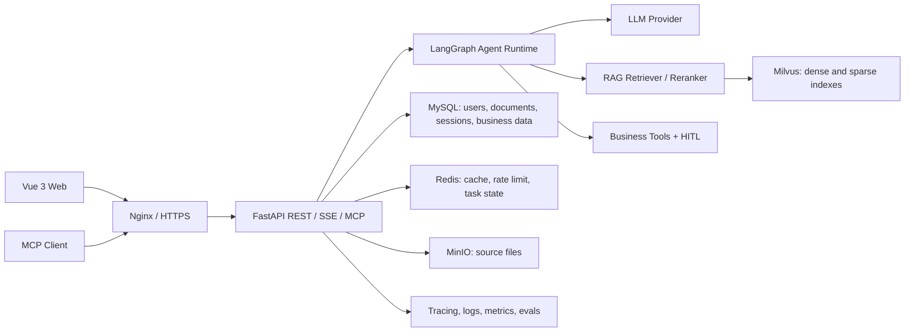

# 企业知识库与智能行动 Agent 平台：简历目标稿

## 使用规则

这是一份“项目完成后的目标版简历”，也是后续开发的验收清单。允许先写计划中的能力，但正式投递前必须满足：

1. 每一项功能都有可运行代码和演示路径。
2. 每一个数字都有测试数据、脚本和原始报告。
3. 未完成或未验证的内容不得写成已经实现。
4. 不使用“高并发、企业级、生产级”等无法证明的空泛词语。

## 项目定位

**项目名称：企业知识库与智能行动 Agent 平台**

**一句话介绍：** 面向企业内部文档与个人工作信息的 RAG + Agent 协作平台，将 PDF、DOCX、Markdown、会议记录和灵感内容统一沉淀为可检索知识，并通过带引用的问答、工具调用和人工审批完成待办创建等业务动作。

**目标岗位：** AI Agent 开发工程师 / RAG 应用开发工程师 / Python AI 应用工程师

**个人职责：** 独立完成需求分析、系统设计、Agent 与 RAG 工作流、FastAPI 服务、数据模型、前端联调、测试评估及容器化部署。

## 业务场景

平台不只保存“灵感”，而是解决下面一条完整业务链：

```text
企业文档、会议记录、聊天内容、个人灵感
                ↓
        解析、切分、索引、权限隔离
                ↓
      带来源引用的知识问答与内容检索
                ↓
       Agent 判断是否需要调用业务工具
                ↓
  用户确认后创建待办、保存结论或调用外部系统
```

典型演示：

1. 员工上传产品手册和项目规范，系统异步建立知识库。
2. 用户提问后获得带文档名、页码和原文片段的回答。
3. Agent 根据问题在直接回答、知识检索、灵感搜索和待办创建之间路由。
4. 涉及数据写入时暂停工作流，展示工具参数，用户确认后恢复执行。
5. 管理员通过日志、Trace 和评估报告定位错误、延迟与 Token 成本。

## 目标技术栈

```text
Agent/RAG     LangChain、LangGraph、Tool Calling、Structured Output、MCP
检索          Embedding、Milvus、Dense + Sparse 混合检索、Reranker
后端          Python、FastAPI、Pydantic、SQLAlchemy 2.x、Alembic
数据          MySQL、Redis、MinIO、Milvus
前端          Vue 3、TypeScript、Vite、Pinia、Element Plus
工程          Docker Compose、Nginx、HTTPS、pytest、mypy、ruff、CI/CD
可观测性      LangSmith 或 Langfuse、结构化日志、延迟与 Token 指标
协议          REST、SSE、MCP stdio、MCP Streamable HTTP
```

## 最终简历版

以下内容在全部完成和验证后，可直接压缩进正式简历。

### 企业知识库与智能行动 Agent 平台

**技术栈：** Python / FastAPI / LangChain / LangGraph / MySQL / Redis / MinIO / Milvus / Vue 3 / Docker

- 基于 LangGraph 构建有状态 Agent 工作流，通过结构化意图路由和 Tool Calling 协同知识库问答、灵感检索与待办创建；使用 Checkpointer 保持会话状态，并通过 `interrupt` 和 `Command` 对写操作实施人工审批。
- 设计端到端 RAG 管道，支持 PDF、DOCX、Markdown、TXT 的异步解析、分块、向量化和来源追踪；结合 Dense + Sparse 混合检索、Reranker 与无答案拒答，在 **N 条**人工评估集上将 Recall@5 从 **X%** 提升至 **Y%**，引用正确率达到 **Z%**。
- 使用 FastAPI、SQLAlchemy 和 MySQL 实现多用户 REST/SSE 服务，通过 JWT、资源归属校验、限流、超时和 Prompt Injection 防护保证访问边界；同时提供带认证和高风险操作确认的 MCP Tools，供外部 Agent 安全调用。
- 基于 MySQL、MinIO、Milvus 和 Redis 设计文档摄取状态机与跨存储补偿机制，实现文件哈希幂等、失败重试、状态查询和级联删除，避免重复索引及孤立向量。
- 使用 Docker Compose、Nginx 与 HTTPS 完成可重复部署，接入 LLM 链路追踪和评估回归；通过单元、Graph 路径、接口、越权及端到端测试覆盖核心流程，压测达到 P95 **X 秒**、错误率 **Y%**。

## 一页简历精简版

当简历空间不足时，只保留下面三条：

- 基于 FastAPI、LangChain 与 LangGraph 构建企业知识库 Agent，支持会话记忆、条件路由、业务工具调用及 HITL 审批，实现知识问答到待办落地的完整闭环。
- 构建支持多格式文档的 RAG 摄取与检索链路，采用 Milvus 混合检索、Reranker、来源引用和拒答策略，并使用离线评估集量化 Recall@5、引用正确率及优化收益。
- 使用 MySQL、Redis、MinIO 和 Docker Compose 完成多用户数据隔离、异步任务、幂等重试、跨存储补偿、SSE 输出及可观测部署，并提供 REST 与 MCP 两类集成接口。

## 当前仓库与目标差距

以下状态依据当前 README 和仓库结构整理，正式投递前还需要重新运行测试确认。

### 当前已有

- Vue 3 + TypeScript 前端和 FastAPI + SQLAlchemy 后端。
- 用户注册登录、JWT 认证和用户数据隔离。
- 灵感与标签的创建、编辑、筛选、软删除及恢复。
- AI 摘要与扩展预览、用户确认后保存、版本号并发保护。
- MySQL + Alembic 数据结构和基础测试。
- 带令牌校验和删除确认的 MCP stdio Tools。
- 健康检查、登录失败退避和基础工程质量脚本。

### 两周核心升级

- LangGraph 会话状态、Checkpoint 和 HITL 审批接入主项目。
- 文档上传、解析、切分、Embedding、MinIO 和 Milvus 入库。
- 带引用 RAG、混合检索、Reranker、拒答和离线评估。
- Agentic RAG 路由：直接回答、知识检索、灵感查询和行动工具。
- SSE 流式事件、Agent 会话接口和前端联调。
- Docker Compose、Nginx、HTTPS、链路追踪、压测与演示材料。

### 后续企业增强

- 组织、工作空间、RBAC、文档级 ACL 和审计日志。
- Redis 支持的可靠任务队列、死信处理、定时重试和任务取消。
- 数据版本、知识库增量更新、备份恢复和生命周期管理。
- 模型路由、Token 预算、语义缓存、降级与熔断。
- MCP Streamable HTTP 的认证、授权、Origin 校验和租户隔离。
- Eval-as-CI：Prompt、模型或检索参数变更时自动执行回归评估。
- Kubernetes、灰度发布和弹性扩缩容仅在核心系统完成后补充。

## 必须采集的真实指标

简历中的数字只从下面的实验产生：

| 指标 | 证明什么 | 采集方式 |
|---|---|---|
| Recall@5 / MRR / NDCG | 检索召回和排序质量 | 固定评估集，对比 Baseline、Hybrid、Rerank |
| 引用正确率 | 回答是否被引用原文支持 | 人工标注或自动评估后抽样复核 |
| 拒答准确率 | 没有证据时是否避免编造 | 同时准备可回答和不可回答问题 |
| 路由准确率 | Agent 是否选择正确分支或工具 | 固定意图数据集和 Graph 路径断言 |
| P50 / P95 / TTFT | 接口与首 Token 延迟 | Locust 或同类压测工具 |
| 错误率 / 超时率 | 服务稳定性 | 固定并发、时长和数据规模 |
| Token / 请求成本 | 模型调用成本 | Trace 中记录输入输出 Token |
| 幂等和补偿成功率 | 数据管道可靠性 | 重复上传和依赖故障注入测试 |

所有报告必须记录：模型、Embedding、Reranker、Chunk 参数、Top K、评估集大小、机器配置和测试日期。

### 当前 Word 简历中的数字承诺

`AI_Agent开发工程师_王泽.docx` 当前只预埋能够明确验收的规模数字：

- 4 类 Agent 路由：直接问答、知识检索、灵感查询、待办创建。
- 4 类文档：PDF、DOCX、Markdown、TXT。
- 100 条人工标注问题集：用于测量 Recall@5 与引用正确率。

当前没有提前填写 Recall@5、引用正确率或 P95 的结果值。项目完成后必须运行真实实验，将实际结果补入简历；如果没有达到预期，也应填写真实数据并解释后续优化方向。

## 项目亮点的面试讲法

### 30 秒介绍

```text
我独立开发了一个企业知识库与智能行动 Agent 平台。它不只是文档聊天，
而是把文档摄取、混合检索、带引用回答、LangGraph 状态路由、工具调用和
人工审批连成完整业务闭环。后端使用 FastAPI，MySQL 保存业务事实，MinIO
保存原文件，Milvus 负责向量检索，Redis 管理短期任务状态；系统同时提供
REST、SSE 和 MCP 接口，并通过评估集、链路追踪和压测验证质量与性能。
```

### 三个重点难题

1. **RAG 质量不是靠感觉判断：** 建立固定评估集，对 Baseline、混合检索和 Reranker 做可重复对比，同时检查引用是否真正支持答案。
2. **Agent 写操作不能完全自治：** 使用 LangGraph Checkpointer、`interrupt()` 和 `Command(resume=...)` 暂停并恢复流程，审批通过后才执行保存或外部调用。
3. **多存储没有统一事务：** MySQL 记录权威状态，以文档 ID 和哈希保证幂等；MinIO 或 Milvus 失败时记录失败阶段并执行可重试补偿。

## 架构目标



## 投递前证据清单

- [ ] 在线演示地址可以完成注册、上传、问答、查看引用和确认待办。
- [ ] GitHub README 包含架构图、时序图、启动步骤和已知限制。
- [ ] OpenAPI、数据库模型和 MCP Tool 契约可查看。
- [ ] Alembic 能在空 MySQL 数据库完整执行。
- [ ] RAG 评估脚本、数据集与 Baseline 对比报告可复现。
- [ ] 压测报告包含并发数、数据规模、P50、P95 和错误率。
- [ ] 单元测试、Graph 路径测试、集成测试和端到端测试通过。
- [ ] 越权访问、Prompt Injection、非法文件和高风险工具有防护测试。
- [ ] Docker Compose 可在新机器启动，数据卷和备份恢复经过验证。
- [ ] 三至五分钟演示视频能够讲清业务价值、架构和技术难点。

## 暂时不要写进简历

在没有真实实现和验证前，不写下面这些内容：

- “支撑百万级用户”“高并发”“生产级 SLA”。
- Kubernetes、微服务、Multi-Agent、GraphRAG、模型微调。
- 没有原始报告支撑的准确率、QPS、延迟和成本降幅。
- 仅仅安装过但没有在核心流程中发挥作用的技术名词。

## 岗位关键词依据

近期 AI Agent / RAG 岗位反复要求以下能力：端到端 RAG、LangGraph 状态与工具编排、Python/FastAPI、向量数据库、评估与回归、可观测性、Docker/CI/CD、安全治理和 HITL。本项目目标围绕这些能力建立可展示证据，而不是追求框架数量。

- https://careers.epam.com/en/vacancy/senior-ai-engineer-agentic-and-rag-systems-blty5mp8mok8tyd6a36_en
- https://job-boards.greenhouse.io/accordion/jobs/7727727
- https://job-boards.greenhouse.io/acquia/jobs/7819079
- https://job-boards.greenhouse.io/nimblegravity/jobs/4692556005
